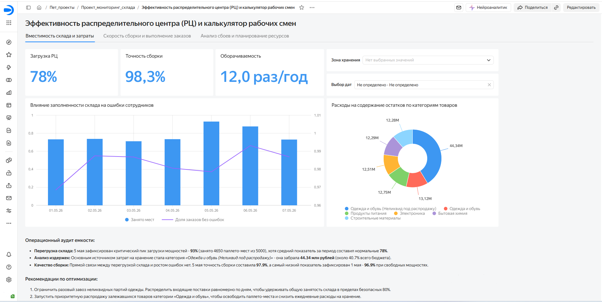
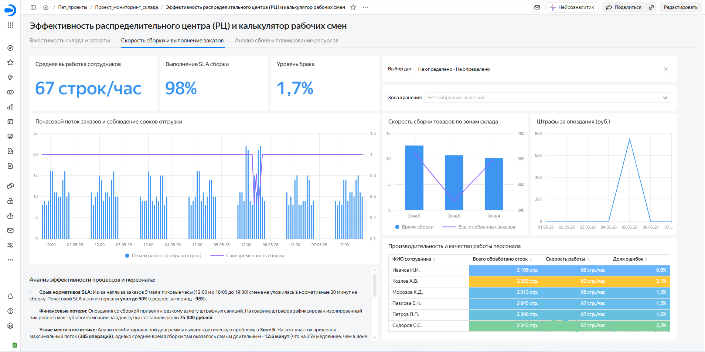
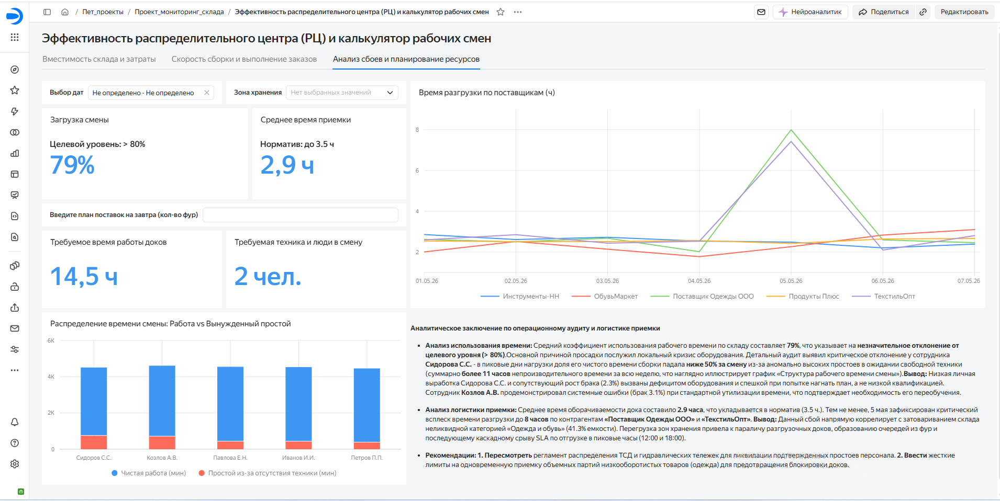

# Дашборд мониторинга производительности и предиктивного анализа ресурсов склада (Yandex DataLens)

🔗 **[Ссылка на интерактивный дашборд в Yandex DataLens](https://datalens.yandex/gxjmgxmsoaes0?_share_link=public)**

---

## 🎯 Описание проекта и бизнес-контекст

Бизнес-ориентированный аналитический проект по оптимизации складской логистики. Цель проекта - оцифровать операционную эффективность распределительного центра (РЦ), выявить причины срыва сроков доставки (SLA), обнаружить скрытые простои персонала и разработать предиктивную модель планирования ресурсов.

В ходе проекта проведен полный цикл аналитической обработки данных: от очистки выгрузок WMS-системы и проектирования аналитических витрин (VIEW) в PostgreSQL (DBeaver) до создания мультистраничного интерактивного дашборда с калькулятором смен в Yandex DataLens.

---

## 🛠️ Стек технологий

* **Database & SQL (PostgreSQL, DBeaver):** Очистка и валидация данных, агрегация метрик, проектирование аналитических витрин (`v_warehouse_perfect_mart`, `v_employee_utilization`, `v_dock_to_stock`).
* **BI-платформа (Yandex DataLens):** Field-mapping, создание аналитических показателей, вычисляемых полей и параметров What-If анализа, визуализация данных и построение дашборда.
* **Формат данных:** Исходные логи WMS и ERP систем (CSV).

---

## 📊 SQL-скрипты и витрины данных

* [01_schema_and_tables.sql](sql/01_schema_and_tables.sql) - DDL-скрипты создания структуры базовых таблиц БД.
* [02_views_creation.sql](sql/02_views_creation.sql) - скрипты создания аналитических витрин данных (`v_warehouse_perfect_mart`, `v_employee_utilization`, `v_dock_to_stock`).
* [03_data_cleaning.sql](sql/03_data_cleaning.sql) - SQL-скрипты валидации и проверки качества данных.

---

## 📈 Подробный разбор листов дашборда

### 📑 Лист 1: Вместимость склада и затраты (Стратегия и мощности)

Фокусируется на глобальных инфраструктурных метриках, утилизации полезного объема и структуре финансовых издержек.

#### Ключевые метрики (KPI) & Наблюдения:
* **Критический перегруз:** Выявлен пиковый перегруз склада 5 мая (загрузка достигла **93%** при целевой норме до **78–80%**).
* **Финансовый аудит хранилища:** Анализ структуры издержек показал, что **44.34 млн рублей (40.7% общего бюджета на хранение)** заморожено в категории *«Одежда и обувь (Неликвид под распродажу)»*.
* **Взаимосвязь загрузки и качества:** Сопоставление динамики емкости и точности сборки опровергло гипотезу о том, что перегруз склада снижает точность операций (точность 5 мая удержалась на уровне **97.9%**). Просадка точности до минимальных **96.9%** зафиксирована 1 мая, что связано с адаптацией смены в начале месяца.

---

### 📑 Лист 2: Скорость сборки и выполнение заказов (Операционная эффективность)

Посвящен почасовому контролю комплектации, соблюдению временного SLA и кадровому аудиту линейного персонала.

#### Ключевые метрики (KPI) & Наблюдения:
* **Провал SLA:** 5 мая из-за всплеска заказов в пиковые часы (12:00 и 16:00–19:00) смена не уложилась в нормативный лимит сборки (20 минут). Почасовой SLA в эти интервалы **рухнул до 50%**, принеся прямые убытки в виде штрафов на **75 000 рублей за сутки**.
* **Анализ узких мест (Топология):** Анализ комбинированной диаграммы «Время сборки vs Объем операций» выявил проблемы в **Зоне Б**. На нее пришелся максимальный поток (**385 операций**), но время сборки оказалось худшим - **12.6 мин** (на 25% медленнее Зоны А). Это указывает на некорректный ABC-анализ (ходовые SKU убраны в дальние ячейки) и возникновение заторов в проходах.
* **Кадровый аудит:** Матрица производительности выявила сотрудников группы риска - **Сидорова С.С.** (52 стр/час, брак 2.3%) и **Козлова А.В.** (63 стр/час, брак 3.1%), показатели которых ниже стандартов склада (норма: 67 стр/час, брак < 1.5%).

---

### 📑 Лист 3: Операционный аудит и логистика приемки + Калькулятор смен (What-If)

Исследует глубокие причины системных сбоев (Dock-to-Stock, утилизация персонала) и содержит инструмент предиктивного планирования.

#### 🔍 Аналитический кейс «Кризис 5 мая»:
В ходе аудита обнаружена комплексная аномалия: 5 мая время разгрузки фур подскакивает до **8 часов** (норматив Док-to-Сток: до 3.5 ч), а полезная загрузка сборщиков падала **ниже 50%**.
* **Инсайт:** Перекрестный анализ витрин `v_dock_to_stock` и `v_employee_utilization` доказал, что проседание выработки Сидорова С.С. (простой более **11 часов за неделю**) произошло из-за дефицита техники (`wait_minutes = 429 мин`). ТСД и гидравлические тележки были экстренно перераспределены со сборки на приемку для ликвидации затора из фур с одеждой.

#### 🔮 Модуль предиктивного прогнозирования (What-If Калькулятор):
Для перехода от реактивного ликвидирования сбоев к проактивному планированию внедрен калькулятор ресурсов на базе пользовательских параметров DataLens:
* **Логика:** На основе исторического норматива обработки одной фуры система рассчитывает потребность в окнах разгрузки, технике и штате на завтра.
* **Результат:** Прозрачный расчет требуемого времени работы доков и количества сотрудников для предотвращения «каннибализации» ресурсов между приемкой и сборкой.

---

## 🎯 Разработанные рекомендации для бизнеса

1. **Категорийному менеджменту:** Ограничить разовый завоз неликвидных партий одежды под акции, распределив входящий поток равномерно для удержания загрузки склада на уровне до 80%.
2. **Управлению запасами:** Санкционировать распродажу/списание залежавшейся категории «Одежда и обувь» для освобождения 40% бюджета хранения.
3. **Диспетчеризации и WMS:** Ввести смещенные 4-часовые смены для усиления команды комплектовщиков в пиковые часы (12:00 и 18:00), устраняя риски просадки SLA.
4. **Топологам склада:** Провести перегруппировку товаров в Зоне Б, перенеся SKU с высокой оборачиваемостью ближе к магистральным проездам (в Зону А).
5. **Начальнику склада:** Закрепить неснижаемый остаток ТСД/тележек за сборщиками и направить отстающих сотрудников (Сидоров, Козлов) на переобучение к лидеру рейтинга - **Иванову И.И.** (69 стр/час, брак 0.6%).
